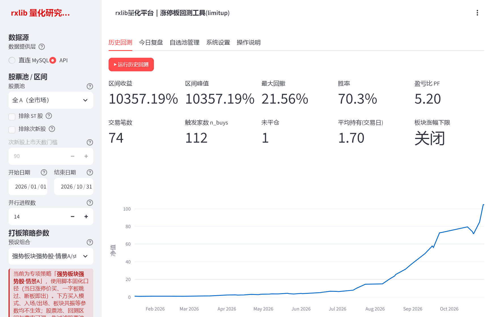
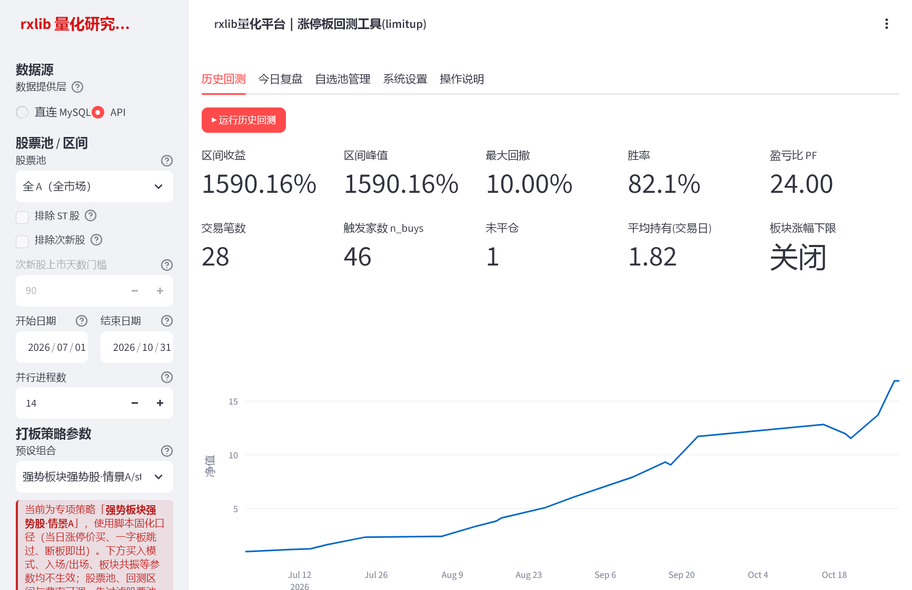

# rxlib 涨停打板量化面板


`rxlib_limitup` 是一个本地运行的 A 股涨停打板量化研究面板：用随包提供的 **便携 Python 3.12** 运行，行情可通过 **rxlib API** 或 **直连 MySQL** 获取。平台只做历史回测与盘后复盘选股，不接实盘交易，对数据库只读。

### 项目信息

| 项目     | 说明                                                  |
| -------- | ----------------------------------------------------- |
| 定位     | A 股涨停打板历史回测 + 盘后复盘选股                   |
| 技术栈   | Python 3.12 ·  pandas · numpy · pymysql               |
| 运行系统 | Windows 10/11 x64（便携 Python 随包提供）             |
| 数据来源 | rxlib API（默认）/ 直连 MySQL                         |
| 默认端口 | `8508`                                                |
| 当前版本 | `1.0.2`（`app/releases/1.0.2`）                       |
| 程序入口 | `app/current/factor_lab_ui.py`                        |
| 许可     | 专有许可，仅限个人非商业使用，详见 [LICENSE](LICENSE) |

***

## 功能模块

| 模块      | 作用                                                                 |
| ------- | ------------------------------------------------------------------ |
| **历史回测** | 用当前打板参数在所选区间完整回测，输出收益/风险指标、净值与回撤曲线、交易明细、参数快照                      |
| **今日复盘** | 盘后盘面统计视图，内含「近10日涨停≥2」与「强势板块」两个功能                                   |
| **自选池管理** | 新建、导入、编辑、下载自定义股票池，保存在本机                                        |
| **系统设置** | 配置数据库/API 参数、修改登录密码、调整面板缓存版本与磁盘持久化、设置平台标题                          |
| **操作说明** | 平台内置的完整使用手册，各控件旁的提示图标也会给出即时说明                                       |

### 历史回测

- 股票池：全 A、按板块（沪市主板 / 深市主板 / 创业板 / 科创板 / 北交所）、自定义池。
- 区间：开始/结束日期；**开始日期等于结束日期时即为“当天打板选股”**。系统会向前多取约 2 个月数据用于指标预热。
- 买入模式：低位首板（低吸）、首板（当日涨停）、高封板强度首板、连板高度≥N、连板接力。
- 买入时点：当日涨停收盘、次日开盘追板、次日收盘追板。
- 过滤条件：连板高度、接力昨日连板数、近 N 日有涨停、高位阈值、封板强度量比、排除 ST、排除次新股。
- 出场条件：止损、止盈、最大持有交易日、断板即出、炸板即出。
- 板块条件：板块涨停家数上下限、封板口径（`seal` / `touch`）、板块涨幅下限、板块层级（TGN / THY1 / THY2 / THY3）。
- 费率：单边费率（bp），买卖各计一次；默认 0。

回测内核在 `limit_up_lab.py`，复用 `factor_lab.py` 构建的数据面板；界面只负责收集参数、调用内核和展示结果。

### 今日复盘

- **近10日涨停≥2**：统计所选交易日满足「近 N 日涨停次数达标」的个股，口径与 `lu10_ge2` 回测严格一致。
- **强势板块**：按“强势板块强势股·情景A”口径对所选交易日的板块与龙头排序。

两个视图仅对已收盘行情做客观统计与呈现，不构成任何投资建议；均独立连库，不依赖回测页的面板状态，数据库不可用时会给出明确提示。

### 自选池管理

- 支持上传 CSV / Excel（`.csv`、`.xls`；`.xlsx` 需在运行时额外放入 `openpyxl`，随包精简运行时未包含）、批量粘贴、表格内直接增删改。
- 代码统一为 6 位数字，兼容 `SH` / `SZ` / `BJ` 前缀；不足 6 位的数字会自动补零。
- 保存后出现在左侧股票池下拉框（前缀“自定义 ·”）。
- 支持下载 UTF-8 与 GBK 两种 CSV；池文件位于 `config/watchlists/*.csv`。

### 系统设置

- 直连数据库参数：host、port、database、user、password，可测试连接并保存。
- API 参数：base_url、token、timeout、是否校验 HTTPS 证书，可测试并保存。
- 登录密码：PBKDF2 哈希保存，本地不保存明文；改密后旧登录令牌立即失效。
- 面板缓存版本：指标算法或面板结构变化时递增，旧缓存自动失效。
- 面板磁盘持久化：开启后重启平台可直接复用已算好的面板。
- 平台标题：左上角展示名称。

### 操作说明

平台内置完整手册（`factor_lab_ui.py` 中的 `HELP_TEXT`），涵盖登录、数据源、参数含义、自选池、缓存与发布裁剪。

***

## 回测结果示例

> **说明**：以下截图均为**选择性展示**——从多种股票池与参数组合中挑出**区间收益最高**的那次回测，不代表平台默认参数、平均表现或可复现收益。

### 2026 年 1 月 — 10 月



- 策略：强势板块强势股·情景A；股票池：全 A；区间：2026/01/01 — 2026/10/31。
- 区间收益 10357.19%，区间峰值 10357.19%，最大回撤 21.56%，胜率 70.3%，盈亏比 5.20，交易 74 笔。

### 2026 年 7 月 — 10 月



- 策略：强势板块强势股·情景A；股票池：全 A；区间：2026/07/01 — 2026/10/31。
- 区间收益 1590.16%，区间峰值 1590.16%，最大回撤 10.00%，胜率 82.1%，盈亏比 24.00，交易 28 笔。

两次回测均为「情景A」口径：当日涨停价买入、断板即出，含当日信号的事后视角（前视），实盘无法完全复现，请结合文末免责声明理解。

***

## 目录结构

```
rxlib_limitup/
├─ start.bat / 启动量化平台.bat   # Windows 双击入口
├─ run.ps1                       # 实际启动脚本（起 Streamlit、开浏览器）
├─ launcher.py                   # 无窗口后台启动器（供开机自启使用）
├─ install-task.ps1              # 注册登录后自动后台运行
├─ uninstall-task.ps1            # 取消开机自启
├─ prune-cache.ps1               # 裁剪本地行情缓存
├─ app/
│  ├─ current/                   # 当前生效版本（自行创建，指向 releases 下的版本）
│  └─ releases/
│     └─ 1.0.2/                  # 发布版本
│        ├─ factor_lab_ui.py                 # 入口（明文）
│        ├─ cache_crypto.py                  # 本地缓存加密（DPAPI）
│        ├─ cache_main.py                    # 缓存裁剪入口
│        ├─ local_settings.py                # 登录、自选池、面板版本
│        ├─ platform_env.py                  # 根目录 / 配置 / 数据目录解析
│        ├─ sql_market.example.py            # 直连 SQL 模板
│        ├─ limit_up_lab.cp312-win_amd64.pyd # 涨停打板内核（已编译）
│        ├─ factor_lab.cp312-win_amd64.pyd   # 数据面板 / 指标 / 回测框架
│        ├─ rx_core.cp312-win_amd64.pyd      # 行情读取与指标计算
│        ├─ data_provider.cp312-win_amd64.pyd # API / MySQL 数据提供层
│        ├─ sql_market.cp312-win_amd64.pyd   # 直连 MySQL 取数
│        ├─ sql_queries.cp312-win_amd64.pyd  # 通用 SQL 片段
│        ├─ sql_system.cp312-win_amd64.pyd   # 交易日 / 系统信息查询
│        ├─ rx_secret.cp312-win_amd64.pyd    # 私有编译模块（运行时必需）
│        ├─ manifest.json / VERSION / favicon.ico
│        ├─ config/config.example.ini
│        └─ docs/api_spec.md
├─ runtime/
│  └─ python312/                 # 便携 Python 3.12 + pylibs（随包提供）
├─ config/
│  ├─ config.ini                 # 真实连接配置（本机生成）
│  └─ watchlists/                # 本机自选池
├─ data/
│  ├─ cache/                     # 行情月片 / 面板 / 盘中缓存
│  └─ results/                   # 回测结果导出
├─ logs/                         # 运行日志
├─ docs/images/                  # README 配图
├─ CHANGELOG.md                  # 版本变更记录
├─ LICENSE
└─ README.md
```

***

## 环境与依赖

- 操作系统：Windows 10/11 x64；启动脚本依赖 Windows PowerShell 5.1。
- Python：`runtime/python312` 内的便携 Python 3.12.6，不要求系统安装 Python。
- 依赖：`runtime/python312/pylibs` 已包含 Streamlit、pandas、numpy、pymysql、plotly/altair、xlrd 等运行依赖；启动脚本通过 `PYTHONPATH` 注入，不使用 pip。
- 编译模块：`rx_secret.cp312-win_amd64.pyd` 必须与运行时匹配（CPython 3.12 / win_amd64）。缺少该文件时 `rx_core.py` 无法导入。
- `runtime/` 约 382 MB / 1.2 万个文件，不随 Git 仓库提供，而是作为 **Release 资产**分发（首次启动会自动下载，见「快速开始」）：

| 资产文件 | 内容 | 大小 |
| --- | --- | --- |
| `runtime.zip` | 完整的 `runtime/python312`（python.exe、DLLs、Lib、tcl、pylibs） | 约 122 MB |

下载地址：<https://gitcode.com/rxlibpub/rxlib-limitup/releases/tag/py312-v1>。把压缩包解压到仓库根目录，最终确保存在：

```
runtime\python312\python.exe
runtime\python312\pylibs\
```

- 开发脚本也建议直接使用该便携运行时，避免本机 Python 版本与 pyd 标签不一致。

***

## 快速开始

### 1. 准备运行时

**无需手动准备**：双击启动脚本时，`run.ps1` 会检测 `runtime\<版本>\python.exe` 与 `runtime\<版本>\pylibs`，缺失时自动从 Release 资产下载并解压：

```
https://gitcode.com/rxlibpub/rxlib-limitup/releases/download/py312-v1/runtime.zip
```

下载约 122 MB，解压后形成 `runtime\python312\...`。如需换镜像或离线安装，可用参数或环境变量覆盖地址：

```powershell
.\run.ps1 -RuntimeUrl "https://你的地址/runtime.zip"
$env:RXLIB_RUNTIME_URL = "https://你的地址/runtime.zip"
```

也可以手动下载该 zip 并解压到仓库根目录，效果相同。

### 2. 准备 app/current

`app/current` 不在仓库中，克隆后不存在，需要自己创建并指向 `app/releases/1.0.2`。推荐用 Junction，这样只维护一份文件：修改 `app/current` 会直接落到 `app/releases/1.0.2`。

如果 `app/current` 已经存在（例如之前创建的实体目录副本），先确认它没有独有改动，再删除并重建联接：

```powershell
# 确认当前是实体目录还是联接
Get-Item app\current | Select-Object LinkType,Target

# 确认 app\current 只是副本/旧联接后删除，再重建指向 1.0.2
Remove-Item app\current -Recurse -Force
cmd /c mklink /J app\current app\releases\1.0.2
```

确认结果：

```powershell
Get-Item app\current | Select-Object LinkType,Target
Get-Content app\current\VERSION
```

切换版本时同样先删联接再重新指向新版本（`1.0.3` 仅为示例，不会删除 `app/releases` 下的真实文件）：

```powershell
cmd /c rmdir app\current
cmd /c mklink /J app\current app\releases\1.0.3
```

### 3. 启动

双击项目根目录下的：

```
start.bat
或者
启动量化平台.bat
```

也可以从 PowerShell 启动：

```powershell
.\run.ps1
.\run.ps1 -Port 8599
```

脚本会读取 `app/current/manifest.json` 选择运行时，设置 `PYTHONPATH`，启动 Streamlit，并在服务就绪后打开浏览器。默认地址：

```
http://localhost:8508
```

端口已被占用时，脚本会直接打开已在运行的页面。

### 4. 首次登录与配置

- 默认访问密码：`rxlib`。登录成功后浏览器会保存 30 天有效的登录令牌；连续输错 5 次会临时锁定 5 分钟。
- 登录后进入「系统设置」，配置 API 或 MySQL 参数并点击保存；保存后配置写入根目录 `config/config.ini`。
- 然后在左侧侧边栏选择数据源与打板参数，进入「历史回测」或「今日复盘」运行。

### 5. 可选：开机自启

```powershell
.\install-task.ps1 -Port 8508
.\uninstall-task.ps1
```

`install-task.ps1` 会在当前用户的启动文件夹生成静默启动器，通过 `pythonw.exe` 运行 `launcher.py`，日志写入 `logs/launcher-YYYYMMDD.log`。注意该脚本自身的默认端口是 `8504`，建议显式传入 `-Port 8508` 与 `run.ps1` 保持一致。

***

## 配置

### 生成 config.ini

仓库只提供配置模板。首次使用请复制模板：

```powershell
Copy-Item app\current\config\config.example.ini config\config.ini
```

模板只包含 `[db]` 段；API、缓存等段可以在「系统设置」保存时自动写入，也可以手动补齐。完整结构如下：

```ini
[meta]
config_version = 1

[db]
host = 127.0.0.1
port = 3306
database = data
user = root
password = 你的数据库口令

[api]
base_url = https://host/api/v1
token = 你的 API Token
timeout = 30
verify_ssl = true

[cache]
panel_disk_cache = false

[intraday]
snapshot_ttl_seconds = 60
```

模板中的 `password = 123456` 只是占位值，必须改成实际口令。

### 字段说明

| 段          | 字段                  | 是否必填          | 说明                                       |
| ---------- | ------------------- | ------------- | ---------------------------------------- |
| `[db]`     | host / port         | 直连 MySQL 时必填  | 行情库地址与端口，默认 `127.0.0.1:3306`               |
| `[db]`     | database / user     | 直连 MySQL 时必填  | 库名与账号                                    |
| `[db]`     | password            | 直连 MySQL 时必填  | 数据库口令                                    |
| `[api]`    | base_url            | API 模式必填      | 服务版本根地址，例如 `https://host/api/v1`          |
| `[api]`    | token               | API 模式必填      | 以 `Authorization: Bearer <token>` 携带     |
| `[api]`    | timeout             | 否             | 请求超时秒数，默认 30                              |
| `[api]`    | verify_ssl          | 否             | 自签名证书可设为 `false`，默认 `true`               |
| `[cache]`  | panel_disk_cache    | 否             | 面板磁盘持久化，默认 `false`                       |
| `[intraday]` | snapshot_ttl_seconds | 否           | 盘中快照缓存秒数，默认 60；0 表示关闭                    |

API 模式优先，只有选择直连 MySQL 时才需要 `[db]`。左侧「数据提供层」可以在两种模式间切换。

### 环境变量覆盖

API 地址与 Token 支持环境变量覆盖，适合临时调试或 CI：

```powershell
$env:RXLIB_API_BASE_URL = 'https://host/api/v1'
$env:RXLIB_API_TOKEN = 'your-token'
```

`RXLIB_HOME` 可显式覆盖平台根目录；`RXLIB_PORT` 可覆盖 `launcher.py` 的默认端口。

***

## 数据目录与缓存

平台采用两层本地缓存，目录为 `data/cache/`：

1. **行情月片**：按月保存原始日线，文件名形如 `_factorlab_kline_YYYYMM.pkl`；两种数据源共用，读过的月份离线也可复用。
2. **面板缓存**：把月片按股票池组装并计算完连板、量比、位置、共振等指标后的结果。默认只放内存；开启「面板磁盘持久化」后落盘为 `_factorlab_panel_*.pkl`。盘中快照缓存形如 `_factorlab_intraday_*.pkl`，基准缓存形如 `_factorlab_bench_*.pkl`。

缓存特征：

- 使用 Windows DPAPI 加密，密钥绑定当前 Windows 用户；复制到其他电脑或其他用户下无法解密。
- 可随时删除并重建；删除后平台会重新取数、重新计算。

裁剪缓存（以最新月片为基准，先预览再删除）：

```powershell
.\prune-cache.ps1 -KeepMonths 6
.\prune-cache.ps1 -KeepMonths 6 -Apply
```

其他目录：

- `data/results/`：回测结果、导出 CSV、研究输出。
- `logs/`：启动错误日志（如 `run-YYYYMMDD.err.log`）与后台启动日志（`launcher-YYYYMMDD.log`）。
- 缓存的自动失效与 `panel_version`、股票池、板块、过滤条件绑定；修改参数或升级面板结构后旧缓存不会被误用。

***

## 常见问题

**Q：克隆后双击 start.bat 提示找不到 manifest.json 或入口？**
A：`app/current` 不在仓库中，克隆后不存在。按“快速开始”把它指向 `app/releases/1.0.2`：`cmd /c mklink /J app\current app\releases\1.0.2`。确认 `app\current\manifest.json` 与 `app\current\factor_lab_ui.py` 存在。

**Q：双击 start.bat 闪退，或提示找不到 Python？**
A：确认 `runtime\python312\python.exe` 与 `runtime\python312\pylibs` 完整存在。仓库不包含运行时，需要单独放置；启动失败信息可查看 `logs/` 下的错误日志。

**Q：报 `ModuleNotFoundError: rx_secret` 或 pyd 加载失败？**
A：确认 `rx_secret.cp312-win_amd64.pyd` 在 `app/current` 下，并且运行时是 CPython 3.12 x64。标签不匹配（例如用 3.10/3.11 或 32 位 Python）会加载失败。

**Q：为什么不能用自带 runtime 编译扩展？**
A：`runtime/python312` 是精简运行时，缺少 `Include` 头文件和 `libs` 导入库，也没有编译器。请用本机完整 CPython 3.12 x64 + 编译工具链构建，再把 pyd 放回 release。

**Q：Windows 下多进程构建面板卡住或报 spawn 错误？**
A：Windows 使用 spawn 启动子进程，入口脚本必须有 `if __name__ == '__main__':` 保护，不能依赖全局可变状态；跨进程尽量少回传大对象。若仍卡住，把“并行进程数”设为 1 再试。

**Q：提示“直连 MySQL 取数失败，已改用本地缓存行情”？**
A：当前选择了直连模式，但 `sql_market` 模块缺失、数据库不可用或账号无权限。可改用 API 模式，或检查 `[db]` 配置与直连 SQL 是否与库结构匹配。

**Q：提示缓存解密失败 / 完整性校验失败？**
A：缓存使用当前 Windows 用户的 DPAPI 密钥加密，换电脑或换用户后无法解密。删除 `data/cache/` 下对应文件后重新运行，平台会重新取数并重建。

**Q：端口被占用 / 想换端口？**
A：`run.ps1` 检测到端口已被占用时会直接打开已有页面。需要换端口用 `.\run.ps1 -Port 8599`；开机自启用 `.\install-task.ps1 -Port 8599`。

**Q：登录被锁定 / 忘记密码？**
A：连续输错 5 次会锁定 5 分钟。默认密码为 `rxlib`；密码以 PBKDF2 哈希保存在 `config/_factorlab_settings.json`，删除该文件会恢复默认密码和默认设置（自选池文件不受影响）。

**Q：导入 `.xlsx` 提示缺少 openpyxl？**
A：随包 `runtime/python312/pylibs` 为精简依赖，未包含 `openpyxl`；`.csv` 与 `.xls` 可直接导入。需要 `.xlsx` 时，把 `openpyxl` 放入 `runtime/python312/pylibs`，或先在 Excel 中另存为 `.xls` / `.csv`。

***

## 免责声明

- 本项目是**量化策略研究与历史回测工具**，不构成任何投资建议，也不推荐直接用于实盘交易。
- 历史回测不代表未来收益，过往表现不预示未来结果。
- 回测对成交做了简化假设：涨停价成交在真实盘中未必能成交，一字板通常买不进，T+1、炸板、滑点、手续费、涨跌停与 ST 规则也无法完全还原。据此操作，风险自担。
- 行情数据来自第三方 API 或本地数据库，平台不保证数据的完整性、准确性与时效性；用于研究前请自行校验。
- 平台对数据库只读，不写任何业务数据表；请使用只读账号，并自行做好数据库备份与访问控制。

## 许可

本项目使用仓库根目录 [LICENSE](LICENSE) 中的**专有许可**：仅限个人非商业使用，未经书面许可不得复制、修改、分发、再授权或商用。它不是 MIT 等开源许可证；如需公开托管或对外分发，请先确认许可证条款与版权人信息是否已填写完整。
